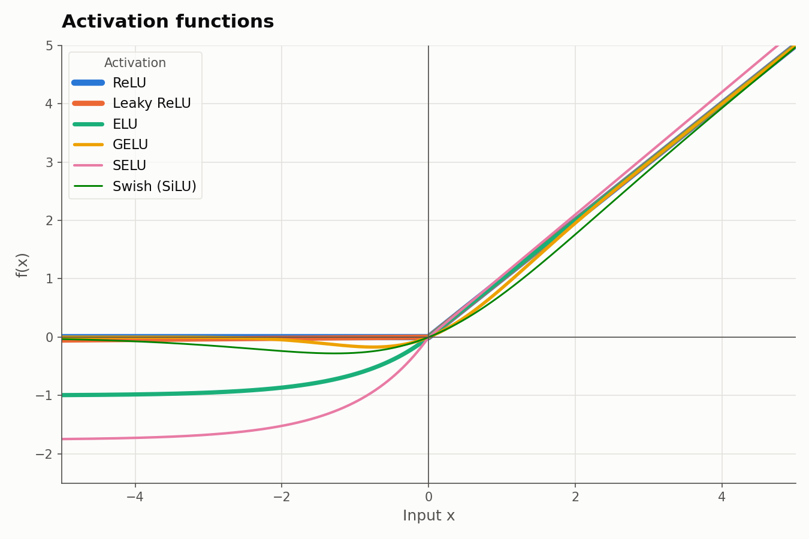
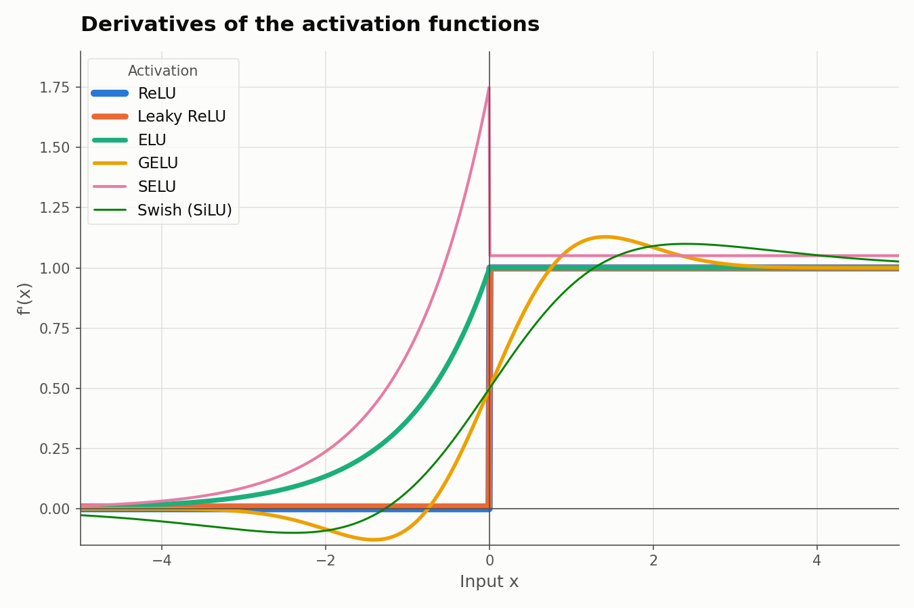
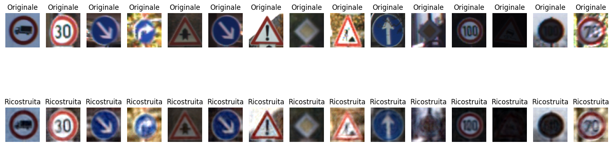
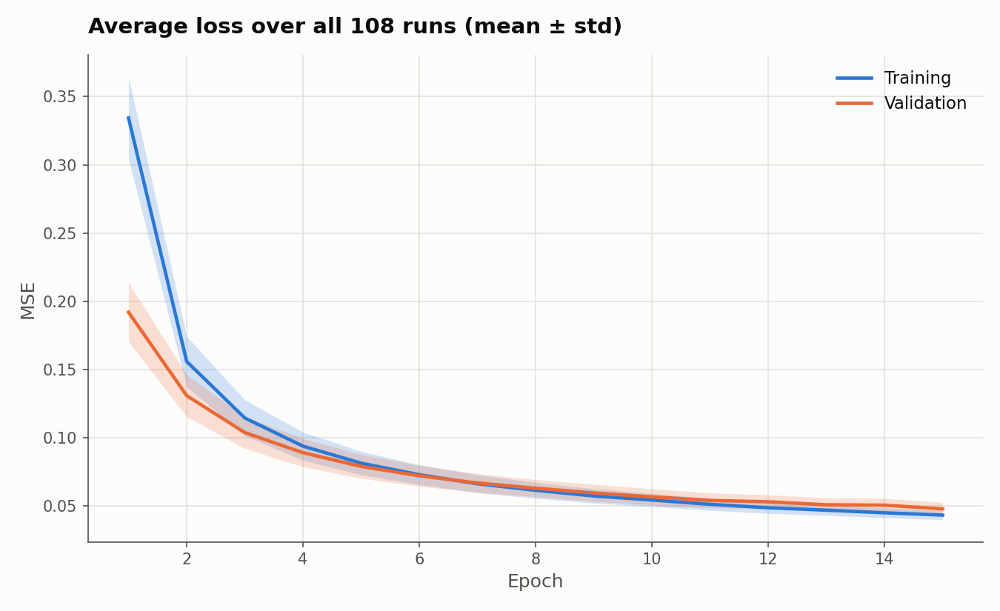
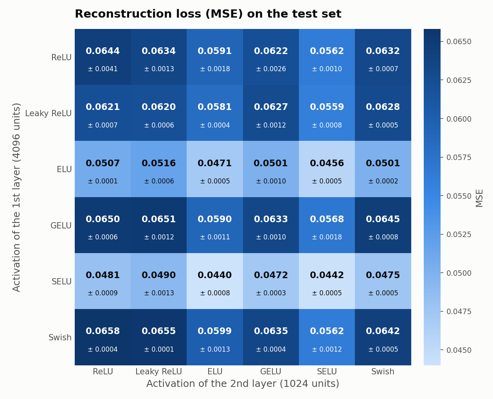
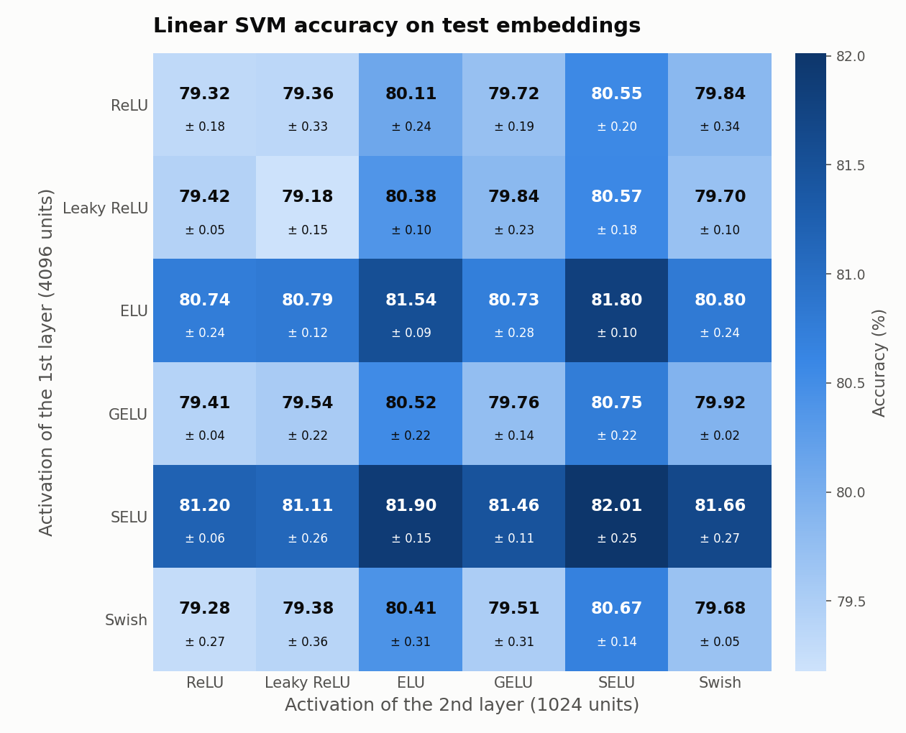
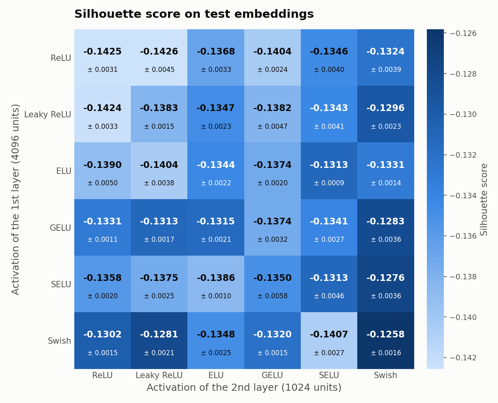
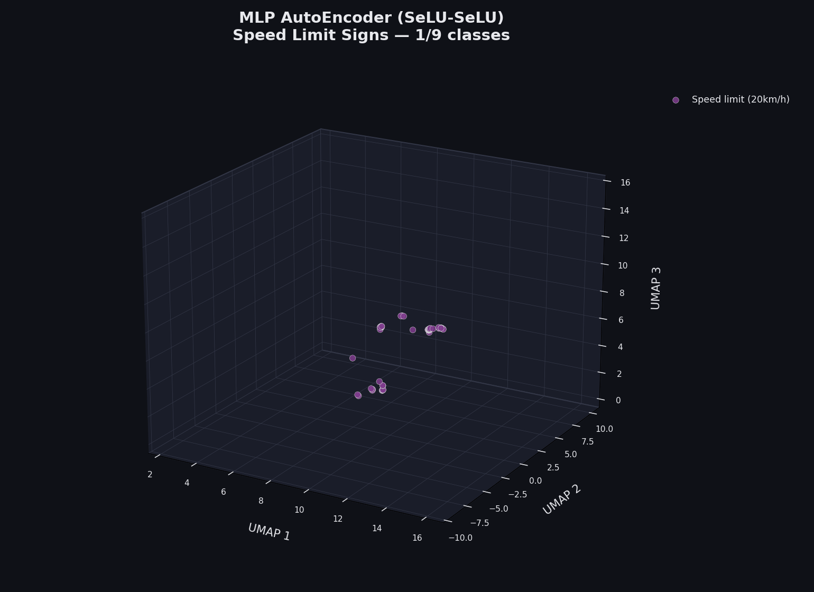
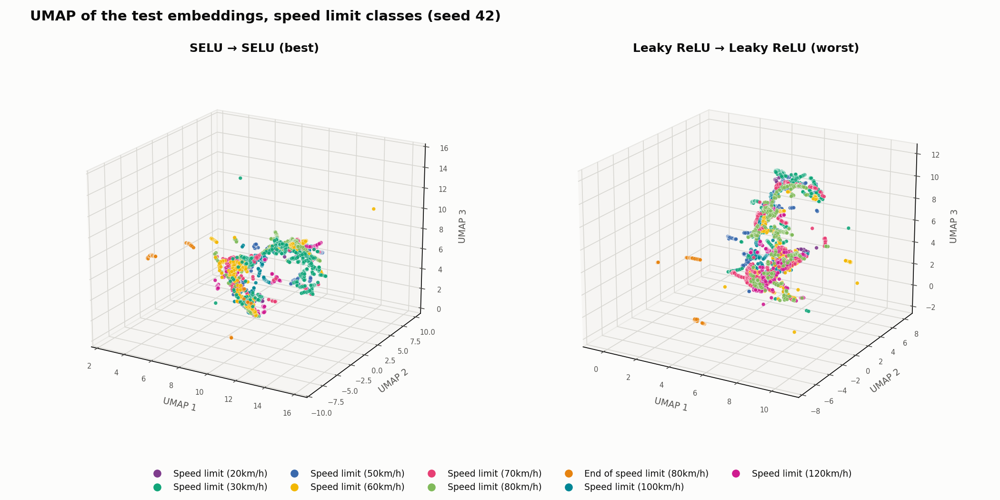
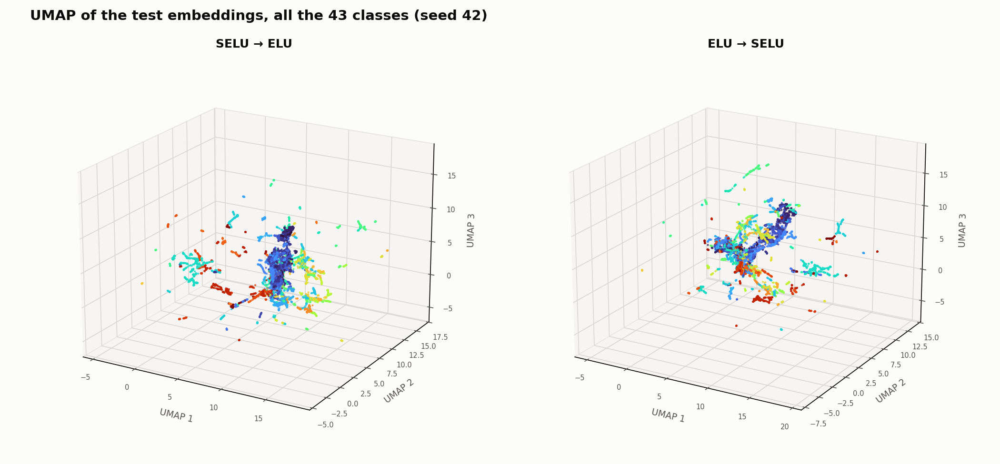

# Exploring Latent Space Geometry and Representation Quality in Suboptimal Architectures: The Impact of Activation Functions on MLP Autoencoders
**Author:** Edoardo Canti

## 1. Introduction
The primary objective of this project is to evaluate the impact of different **activation functions** and their **layer order** on the **latent space geometry** and **representation quality** of an MLP **AutoEncoder** trained on the **GTSRB dataset**.

Although Multi-Layer Perceptrons are inherently suboptimal for computer vision tasks due to their lack of spatial invariance, this architectural simplicity served as a good setup to isolate the behavior of activations. The representations are evaluated both quantitatively through **linear probing** (SVC classification accuracy and Silhouette Score) and qualitatively via 3D **manifold visualization** (UMAP).

In order to reach the goal several experiments have been conducted considering the following **activations**:

1. [ReLU](https://pytorch.org/docs/stable/generated/torch.nn.ReLU.html "ReLU activation function on PyTorch")
2. [Leaky ReLU](https://pytorch.org/docs/stable/generated/torch.nn.LeakyReLU.html "Leaky ReLU activation function on PyTorch")
3. [ELU](https://pytorch.org/docs/stable/generated/torch.nn.ELU.html "ELU activation function on PyTorch")
4. [GELU](https://pytorch.org/docs/stable/generated/torch.nn.GELU.html "GELU activation function on PyTorch")
5. [SELU](https://pytorch.org/docs/stable/generated/torch.nn.SELU.html "SELU activation function on PyTorch")
6. [Swish (SiLU)](https://pytorch.org/docs/stable/generated/torch.nn.SiLU.html "Swish activation function on PyTorch")

Previous activations have been combined in a **Multi-Layer Perceptron AutoEncoder** with two hidden layers. 

This configuration led to a total of 36 configurations. Each configuration was trained with 3 different seeds.

## 2. Theoretical Background

### 2.1 Activation Functions
Activation functions introduce non-linearity into neural networks, allowing them to learn complex patterns. In an AutoEncoder, the choice of activation affects how gradients flow during backpropagation and how the information is transformed from one layer to the next.

Below is a brief overview of the activation functions evaluated in this study and of the parameters used in the experiments:

#### 2.1.1 ReLU & Leaky ReLU
* **ReLU:** $f(x) = \max(0, x)$. No parameters. Positive inputs pass unchanged, negative inputs become zero.
* **Leaky ReLU:** $f(x) = \max(\alpha x, x)$, with $\alpha = 0.01$ (`negative_slope`, PyTorch default). Like ReLU, but negative inputs are scaled by a small factor instead of being zeroed.

#### 2.1.2 ELU & GELU
* **ELU:** $f(x) = x$ for $x > 0$, $f(x) = \alpha\,(e^{x} - 1)$ for $x \le 0$, with $\alpha = 1.0$ (PyTorch default). Positive inputs pass unchanged, negative inputs follow a smooth curve that flattens towards $-\alpha$.
* **GELU:** $f(x) = x \cdot \Phi(x)$, where $\Phi(x)$ is the cumulative distribution function of the standard Gaussian. We use the exact formulation (`approximate='none'`, PyTorch default). A smooth curve that dips slightly below zero for small negative inputs and then returns towards zero.

#### 2.1.3 SELU & Swish (SiLU)
* **SELU:** $f(x) = \lambda x$ for $x > 0$, $f(x) = \lambda \alpha\,(e^{x} - 1)$ for $x \le 0$, with the fixed constants $\lambda \approx 1.0507$ and $\alpha \approx 1.6733$ (PyTorch). A scaled version of ELU, whose negative side flattens at about $-\lambda\alpha \approx -1.76$.
* **Swish (SiLU):** $f(x) = x \cdot \sigma(x)$, where $\sigma(x)$ is the sigmoid function. No parameters (PyTorch `nn.SiLU`, i.e. Swish with $\beta = 1$). A smooth curve that dips slightly below zero and then returns towards zero.

### 2.2 AutoEncoders
In the AutoEncoder framework two distinct components are employed:
- An encoder $f_\theta$ that maps the input $\mathbf{x}^{(i)} \in \mathbb{R}^{D}$ in a latent space representation $\mathbf{z}^{(i)} = f_\theta(\mathbf{x}^{(i)}) \in \mathbb{R}^{K}$
- A decoder $g_\phi$ that maps the latent space representation back into the input space $\hat{\mathbf{x}}^{(i)} = g_\phi(\mathbf{z}^{(i)})$

The process of evaluating the reconstructed signal $\hat{\mathbf{x}}^{(i)}$, with respect to the input signal $\mathbf{x}^{(i)} \in \mathbb{R}^{D}$, is the process through which we understand if the AutoEncoder framework has learnt to represent the input in a dimensional vector space of smaller size. Since the latent space dimension is usually smaller than the input space one, the network cannot simply copy its input: it has to keep the information that it needs to rebuild it. Whether it succeeds is judged by comparing $\hat{\mathbf{x}}^{(i)}$ with $\mathbf{x}^{(i)}$, and to compare them we need a single number that measures how far apart they are: a **loss function**.

### 2.3 Reconstruction loss: Mean Squared Error
The loss used in this project is the Mean Squared Error (MSE)
$$\mathcal{L}_{MSE} = \frac{1}{N\,D}\sum_{i=1}^{N}\sum_{j=1}^{D}\left(x_j^{(i)} - \hat{x}_j^{(i)}\right)^2$$

Please note that, by employing a Mean Squared Error, the network's only goal is to reduce the reconstruction error: it does not matter how the latent space is organized, and the network will find the geometry that serves this goal.

## 3. Methodology
The interest is to evaluate quantitatively and qualitatively how the latent space geometry changes with respect to the application order of activation functions. 

### 3.1 Dataset and preprocessing
The experiments were carried out on the **German Traffic Sign Recognition Benchmark (GTSRB)**, loaded through `torchvision.datasets.GTSRB`. It contains color images of traffic signs belonging to 43 classes, with 26,640 images in the training split and 12,630 in the test split.

Original images have different sizes, so each image is first resized so that its shorter side is 70 pixels and then **center-cropped** to $64 \times 64$ pixels (a small margin around the sign is discarded). Pixel values are then normalized channel-wise using the ImageNet mean and standard deviation.

Each input is therefore a tensor of shape $3 \times 64 \times 64$. Since the model is a Multi-Layer Perceptron, made only of fully connected layers, the image is **flattened** into a vector of $D = 3 \cdot 64 \cdot 64 = 12288$ values. Each pixel is just one coordinate of the input vector, so an MLP does not introduce any notion of locality by itself. It can learn spatial relations between pixels from the data, but nothing in the architecture forces it to.

*Example of original images (top row) and their reconstruction (bottom row) produced by one of the trained AutoEncoders. Labels are in Italian: "Originale" is the original image, "Ricostruita" is the reconstructed one.*

### 3.2 Latent space
The encoder compresses the flattened input into a latent vector of $K = 512$ dimensions, a 24× reduction. Once the training is over the **decoder is discarded**: it is only needed to compute the reconstruction loss, and every analysis of the following sections is carried out on the embeddings $\mathbf{z}$ produced by the encoder alone.

### 3.3 Architectural choices
**Why a Multi-Layer Perceptron.** The goal of this study is not to reach the best possible accuracy, but to observe how the latent space geometry changes when the activation functions change. A stack of fully connected layers is the simplest architecture in which the activation functions are the only source of non-linearity between the input and the latent space, so the differences between two models can be attributed to the activations and to their order, and not to other architectural components.

Also note that the network does not force the embeddings to lie on the unit hypersphere, so the information of an embedding can be carried both by its direction and by the length of the vector. However, before the evaluation the embeddings are L2-normalized (see 3.5), so only the direction is analyzed.

**Number of epochs.** The number of epochs (15) was set for experimental purposes, and the models are not fully converged: the loss curves were still decreasing at the last epoch. The results must therefore be read as a comparison between activation functions at equal training budget.

### 3.4 Training
Each configuration was trained on the training split, holding out 20% of the images (stratified by class) as a validation set to monitor the loss. The optimizer is **AdamW** with learning rate $10^{-4}$ and weight decay $10^{-4}$, batches of 64 images and 15 epochs. No early stopping is used, the model kept is the one at the last epoch.

Every configuration was trained with 3 different seeds (42, 999 and 2026), for a total of $36 \times 3 = 108$ trained models.

### 3.5 Quantitative evaluation
Once the training is over, the embeddings of the whole training split and of the test split are extracted with the encoder and L2-normalized. Two metrics are then computed:
- **Linear probing:** a linear SVM (`LinearSVC` from scikit-learn) is trained on the training embeddings to predict the class of the traffic sign, and its accuracy is measured on the test embeddings. The higher the accuracy, the more linearly separable the classes are in the latent space.
- **Silhouette score:** computed on the test embeddings with the Euclidean distance, using the true classes as clusters. It goes from $-1$ to $1$ and compares how close the points of a class are to each other with respect to how far they are from the other classes. Values close to $0$ or negative mean that the classes overlap.

Both metrics are reported as mean ± standard deviation over the 3 seeds. Labels are used only here, never to train the AutoEncoder.

### 3.6 Latent space visualization
As mentioned, the latent space has a dimension of $K = 512$. To visualize the impact of the activation functions, **UMAP** has been employed to obtain a three-dimensional representation of the space.

UMAP works in two steps. First, each embedding is connected to its closest neighbors in the 512-dimensional space (here 15 neighbors, using the cosine distance, which is consistent with the L2 normalization). Then the points are placed in 3D trying to keep those same neighbors close to each other. In practice, points that are close in the latent space end up close in the plot.

## 4. Results

In the following heatmaps rows are the activation of the first layer (4096 units) and columns the activation of the second layer (1024 units). Each cell reports mean and standard deviation over the 3 seeds.

### 4.1 Reconstruction

The figure shows training and validation loss averaged over all the 108 runs. Both drop quickly in the first epochs and then slow down, but they have not flattened at epoch 15 (see 3.3). Training and validation losses are very close.

*In this heatmap, differently from the following ones, the darker the cell the **worse** the result (higher MSE).*

The test MSE ranges from 0.0440 (SELU → ELU) to 0.0658 (Swish → ReLU). Looking at the heatmap:
- **ELU and SELU in the first layer** give the lowest losses (from 0.0440 to 0.0516). With any other activation in the first layer the loss is between 0.0559 and 0.0658.
- **ELU or SELU in the second layer** lower the loss in every row of the heatmap. For example, with ReLU in the first layer the MSE is 0.0644 using ReLU in the second layer, and 0.0562 using SELU.
- **ReLU, Leaky ReLU, GELU and Swish** behave very similarly to each other, wherever they are placed.

### 4.2 Linear probing

The accuracy of the linear SVM goes from 79.18% (Leaky ReLU → Leaky ReLU) to 82.01% (SELU → SELU), less than 3 points of difference. Standard deviations over the seeds are between 0.02 and 0.36 points. The picture is similar to the reconstruction:
- **ELU and SELU in the first layer** give the best accuracies. The 12 configurations that use them in the first layer are all among the top 13 of the ranking.
- **ELU or SELU in the second layer** improve the accuracy in every row of the heatmap.

The differences between the top configurations are small compared to the standard deviations: for example SELU → SELU (82.01 ± 0.25) and SELU → ELU (81.90 ± 0.15) are very close.

### 4.3 Silhouette score

All the Silhouette scores are negative, between $-0.1426$ and $-0.1258$. This means that, on average, a point is closer to the points of another class than to the points of its own class. The range is very narrow (less than 0.02) and comparable with the standard deviations over the seeds (from 0.0009 to 0.0058), so the differences are small.

The ranking is different from the one of the linear probing:
- **Swish** gives the best scores: the four best configurations all use it, either in the first or in the second layer. As second layer, it gives the best Silhouette in 5 rows out of 6.
- **Swish → Swish has the best Silhouette ($-0.1258$) but only the 27th accuracy out of 36 (79.68%)**.
- The three worst configurations use only ReLU and Leaky ReLU (ReLU → Leaky ReLU, ReLU → ReLU and Leaky ReLU → ReLU).

### 4.4 Complete results
Each row is a configuration, written as the activation of the first layer → the activation of the second layer (for example, SELU → Swish has SELU after the first layer of 4096 units and Swish after the second layer of 1024 units). Rows are sorted by linear SVM accuracy. Values are mean ± standard deviation over the 3 seeds.

| # | Configuration | SVM accuracy (%) | Silhouette | Test MSE |
|---|---|---|---|---|
| 1 | SELU → SELU | 82.01 ± 0.25 | -0.1313 ± 0.0046 | 0.0442 ± 0.0005 |
| 2 | SELU → ELU | 81.90 ± 0.15 | -0.1386 ± 0.0010 | 0.0440 ± 0.0008 |
| 3 | ELU → SELU | 81.80 ± 0.10 | -0.1313 ± 0.0009 | 0.0456 ± 0.0005 |
| 4 | SELU → Swish | 81.66 ± 0.27 | -0.1276 ± 0.0036 | 0.0475 ± 0.0005 |
| 5 | ELU → ELU | 81.54 ± 0.09 | -0.1344 ± 0.0022 | 0.0471 ± 0.0005 |
| 6 | SELU → GELU | 81.46 ± 0.11 | -0.1350 ± 0.0058 | 0.0472 ± 0.0003 |
| 7 | SELU → ReLU | 81.20 ± 0.06 | -0.1358 ± 0.0020 | 0.0481 ± 0.0009 |
| 8 | SELU → Leaky ReLU | 81.11 ± 0.26 | -0.1375 ± 0.0025 | 0.0490 ± 0.0013 |
| 9 | ELU → Swish | 80.80 ± 0.24 | -0.1331 ± 0.0014 | 0.0501 ± 0.0002 |
| 10 | ELU → Leaky ReLU | 80.79 ± 0.12 | -0.1404 ± 0.0038 | 0.0516 ± 0.0006 |
| 11 | GELU → SELU | 80.75 ± 0.22 | -0.1341 ± 0.0027 | 0.0568 ± 0.0018 |
| 12 | ELU → ReLU | 80.74 ± 0.24 | -0.1390 ± 0.0050 | 0.0507 ± 0.0001 |
| 13 | ELU → GELU | 80.73 ± 0.28 | -0.1374 ± 0.0020 | 0.0501 ± 0.0010 |
| 14 | Swish → SELU | 80.67 ± 0.14 | -0.1407 ± 0.0027 | 0.0562 ± 0.0012 |
| 15 | Leaky ReLU → SELU | 80.57 ± 0.18 | -0.1343 ± 0.0041 | 0.0559 ± 0.0008 |
| 16 | ReLU → SELU | 80.55 ± 0.20 | -0.1346 ± 0.0040 | 0.0562 ± 0.0010 |
| 17 | GELU → ELU | 80.52 ± 0.22 | -0.1315 ± 0.0021 | 0.0590 ± 0.0011 |
| 18 | Swish → ELU | 80.41 ± 0.31 | -0.1348 ± 0.0025 | 0.0599 ± 0.0013 |
| 19 | Leaky ReLU → ELU | 80.38 ± 0.10 | -0.1347 ± 0.0023 | 0.0581 ± 0.0004 |
| 20 | ReLU → ELU | 80.11 ± 0.24 | -0.1368 ± 0.0033 | 0.0591 ± 0.0018 |
| 21 | GELU → Swish | 79.92 ± 0.02 | -0.1283 ± 0.0036 | 0.0645 ± 0.0008 |
| 22 | ReLU → Swish | 79.84 ± 0.34 | -0.1324 ± 0.0039 | 0.0632 ± 0.0007 |
| 23 | Leaky ReLU → GELU | 79.84 ± 0.23 | -0.1382 ± 0.0047 | 0.0627 ± 0.0012 |
| 24 | GELU → GELU | 79.76 ± 0.14 | -0.1374 ± 0.0032 | 0.0633 ± 0.0010 |
| 25 | ReLU → GELU | 79.72 ± 0.19 | -0.1404 ± 0.0024 | 0.0622 ± 0.0026 |
| 26 | Leaky ReLU → Swish | 79.70 ± 0.10 | -0.1296 ± 0.0023 | 0.0628 ± 0.0005 |
| 27 | Swish → Swish | 79.68 ± 0.05 | -0.1258 ± 0.0016 | 0.0642 ± 0.0005 |
| 28 | GELU → Leaky ReLU | 79.54 ± 0.22 | -0.1313 ± 0.0017 | 0.0651 ± 0.0012 |
| 29 | Swish → GELU | 79.51 ± 0.31 | -0.1320 ± 0.0015 | 0.0635 ± 0.0004 |
| 30 | Leaky ReLU → ReLU | 79.42 ± 0.05 | -0.1424 ± 0.0033 | 0.0621 ± 0.0007 |
| 31 | GELU → ReLU | 79.41 ± 0.04 | -0.1331 ± 0.0011 | 0.0650 ± 0.0006 |
| 32 | Swish → Leaky ReLU | 79.38 ± 0.36 | -0.1281 ± 0.0021 | 0.0655 ± 0.0001 |
| 33 | ReLU → Leaky ReLU | 79.36 ± 0.33 | -0.1426 ± 0.0045 | 0.0634 ± 0.0013 |
| 34 | ReLU → ReLU | 79.32 ± 0.18 | -0.1425 ± 0.0031 | 0.0644 ± 0.0041 |
| 35 | Swish → ReLU | 79.28 ± 0.27 | -0.1302 ± 0.0015 | 0.0658 ± 0.0004 |
| 36 | Leaky ReLU → Leaky ReLU | 79.18 ± 0.15 | -0.1383 ± 0.0015 | 0.0620 ± 0.0006 |

 
The table shows that the quality of the clusters (Silhouette) is not correlated with the accuracy on the test set. This is not surprising, since the models were never trained to separate the classes. However, it tells us that, even though none of the models reached convergence, the learnt embeddings, even if the classes are not well separated in the latent space, still allow a good linear separation. This can be considered a good result, since the architecture is suboptimal for images.

### 4.5 Inverted activations
Some configurations in the table use the same two activations in inverted order. We look at three of them:
- **SELU → Swish** has an accuracy of 81.66%, while **Swish → SELU** has 80.67%.
- **ELU → ReLU** has an accuracy of 80.74%, while **ReLU → ELU** has 80.11%.
- **SELU → ELU** has an accuracy of 81.90%, while **ELU → SELU** has 81.80%.

In the first two examples the configuration with ELU or SELU in the first layer is better, by about 1 and 0.6 points. The same happens in all the other pairs that contain one of these two activations and one of ReLU, Leaky ReLU, GELU or Swish, which can be found in the table (the difference goes from 0.2 to 1.0 points). When the two activations are SELU and ELU, instead, the two orders are very close.

### 4.6 UMAP visualization
The following plots are computed on the test embeddings of seed 42 (see 3.6).

The animation adds one speed limit class at a time to the UMAP of the best model (SELU → SELU). The first class (20km/h) has only 60 images in the test set, and its points form a few small separated groups instead of a single cloud. As more classes are added, most of them end up overlapping in the same region, which has a ring-like shape. The class "End of speed limit (80km/h)" (150 images) stays in small groups far from the rest. Note that classes are drawn in order, so the points of the classes drawn later can cover the previous ones: for example the 50km/h class (blue) has 750 images, but few of its points are visible.

The figure compares the best model (SELU → SELU, 82.01% of accuracy) and the worst one (Leaky ReLU → Leaky ReLU, 79.18%) on the speed limit classes. In both models the classes are mostly mixed together and are not clearly separated, which is consistent with the negative Silhouette scores. The overall shape is different: a ring-like structure for SELU → SELU and a more elongated one for Leaky ReLU → Leaky ReLU. The class "End of speed limit (80km/h)" (orange) appears as small groups separated from the rest in both. In both plots the points often follow thin and elongated curves, instead of forming round clusters.

The last figure shows the two orders of SELU and ELU with all the 43 classes. The two configurations have a very similar accuracy (81.90% and 81.80%) and I do not see a clear difference between the two plots.

These plots are only a visual illustration: UMAP distorts distances (see 3.6) and each plot comes from a single trained model.

## 5. Conclusions
The activation functions, and the order in which they are used, change the quality of the learnt representations, even if the differences are not large (from 79.18% to 82.01% of linear SVM accuracy, from 0.0440 to 0.0658 of test MSE).

- **ELU and SELU** give the best results, both in reconstruction and in linear probing. They work better when they are placed in the first layer, and also in the second one. ReLU, Leaky ReLU, GELU and Swish are close to each other.
- **The order of the activations** matters in the pairs we looked at, when one of the two is ELU or SELU: having it in the first layer gives a higher accuracy.
- **The Silhouette score does not follow the accuracy.** All the scores are negative and in a very narrow range, and the best ones are obtained with Swish, which is not among the best in linear probing.
- **Even if the architecture is suboptimal for images and the models are not converged,** the embeddings allow a reasonable linear separation of the classes.

### 5.1 Limitations and future work
- **Convergence.** All the models were trained for 15 epochs and the loss was still decreasing. The experiment could be repeated training until convergence, to see if the differences between the activation functions remain, or if they were mostly due to how fast each configuration learns.
- **Architecture.** An MLP was chosen to isolate the effect of the activation functions, but it is not adequate for images. Repeating the study with a convolutional AutoEncoder would be interesting, to see how the activation functions behave when the spatial structure of the images is exploited.

## 6. Reproducibility
The folders `experiments/` (trained models, embeddings and results of each run) and `_data/` (the dataset) are not included in the repository because of their size: the saved models alone take about 52 GB. To reproduce the results:

1. Install the dependencies (Python 3.9): `pip install -r requirements.txt`
2. Run the following scripts from the `src/` folder, since paths are relative to it:
   - `python training.py` trains the 36 configurations with the 3 seeds (108 models), saving them in `experiments/`. It also downloads the GTSRB dataset in `_data/`. It is the longest step.
   - `python extract_embeddings.py` extracts the embeddings of the training and test sets with every trained encoder.
3. Run the notebooks in `src/`:
   - `embedding_evaluation.ipynb`: linear probing and Silhouette score
   - `results_analysis.ipynb`: tables, heatmaps and loss curves of section 4
   - `umap_visualization.ipynb`: UMAP plots and animation
   - `activation_functions_plots.ipynb`: plots of the activation functions of section 2.1

The hyperparameters (layer sizes, activation functions, learning rate, epochs, batch size) are set in `config.yaml`.

## 7. Notes (AI usage)
The experiments, the training code and the analysis choices are my own. Claude was used to help with the plots and tables of the results (heatmaps, loss curves, UMAP figures), to fix a bug in the evaluation notebook, and to review and correct the English of this report.